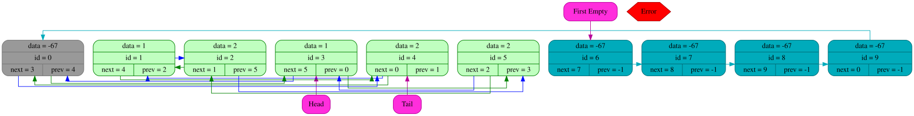
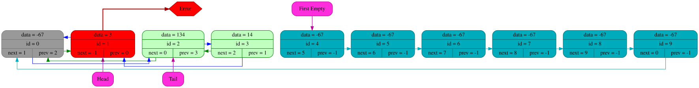
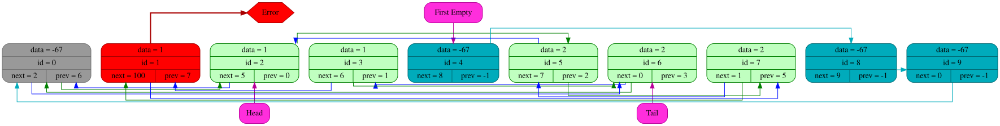

# Двусвязный список с графической визуализацией состояния с помощью graphiz и DOT
Данный проект является реализацией кольцевых [двусвязных списков](https://en.wikipedia.org/wiki/Doubly_linked_list) c фиктивным нулевым элементом и вывода их состояния с использованием графической визуализации (graphviz + DOT)

## Концепция реализации
Основным отличием данной реализации от общепринятой(например контейнер list в стандартной библиотеке языка C++) является хранение всех элементов списка в одном массиве и осуществление доступа к элементам по их индексам в массиве (итераторам). Иначе говоря, каждый элемент хранит не указатель на следующий и предыдущий элементы в списке, а их индексы в массиве.

Плюсы такого подхода:
- удобно для кэширования (данные лежат последовательно друг за другом)
- быстро (нет постоянных аллокаций при добавлении новых элементов, добавления происходит за O(1))

Минусы:
- реаллокации происходят при переполнении массива, что может вызывать задержки в "случайные" моменты времени(среднее время добавления все равно остается O(1))

Так же программа имеет достаточно богатый набор инструментов для отладки и обработки ошибок (подробнее в разделе [Отладка и обработка ошибок](#отладка-и-обработка-ошибок))

## Доступные функции и возможности

Тип элементов в списке определяется в заголовочном файле `list_struct.h`

`typedef ... data_t;`

`#define format_specifier "..."`


При необходимости можно заменить стоящий по умолчанию тип `int` и спецификатор формата `%d` на необходимый целочисленный тип / тип с плавающей точкой.

>[!WARNING]
>При замене типа данных на тип структуры и другие "сложные" типы, могут возникнуть проблемы с выводом списка (не тестировалось)

При инициализации списка все его элементы являются пустыми и входят в вспомогательный односвязный список пустых элементов
Нулевой элемент играет роль фиктивного элемента для закольцованности списка. Он не является ни пустым, ни заполненным, но позволяет исключить обработку частного случая добавления в пустой (см. подраздел [Фиктивный элемент и закольцованность](#фиктивный-элемент-и-закольцованность))

Здесь и далее под получением элемента подразумевается получение его индекса в массиве (итератора на элемент)

Работа со списком происходит через следующие функции:
| Функция | Использование |
|-----|----|
|ListInit            | Конструктор списка. Выделяет память и задаёт структуру списка пустых элементов |
|ListDestroy         | Деконструктор списка. Освобождает память, заполняет освобожденную память "ядовитым" значением. Обязательна для вызова по окончанию работы со списком |
|GetHead            | Функция получения головы списка |
|GetTail            | Функция получения хвоста списка |
|Next               | Функция получения следующего за данным элемента  |
|Prev               | Функция получения предыдущего элемента для данного |
|InsertAfter        | Функция добавления элемента список после данного |
|InsertBefore       | Функция добавления элемента в список перед данным |
|InsertToHead       | Функция добавления нового элемента в голову списка (становится новой головой)|
|InsertToTail       | Функция добавления нового элемента в хвост списка (становится новым хвостом)|
|DeleteByIterator   | Функция удаления данного элемента из списка|
|DeleteFromHead     | Функция удаления головного элемента из списка|
|DeleteFromTail     | Функция удаления хвостового элемента из списка|
|ListVerifier       | Функция верификации состояния списка для отлова ошибок построения. Вызывается другими функциями в режиме отладки (подробнее в разделе [Отладка и обработка ошибок](#отладка-и-обработка-ошибок))|
|GraphDump          | Функция графического вывода состояния списка в формате .svg. Результат будет сохранен в папкe `/logs/img` и будет сделана запись в лог-файл `/logs/htm/LOG.htm`.
Автоматически вызывается функциями, входящими в интерфейс списка только в режиме логирования|


## Список пустых элементов
Все элементы массива не входящие в список, формируют свой односвязный список, это позволяет делать вставку и удаление в список за O(1).
Любой элемент удалённый из списка становится новой головой списка пустых элементов.
Итератор на голову списка пустых элементов хранится в поле `first_empty_iterator` структуры `list_t`

>[!NOTE]
>Признаком того, что элемент является пустым служит значение -1 в поле `prev`. По данному признаку элементы распознаются "графическим дампом", не стоит менять это значение вручную.

## Фиктивный элемент и закольцованность
Список фактически является кольцевым, и замкнутым на нулевой(фиктивный) элемент.

Это позволяет программе избежать отдельной обработки случаев добавления/удаления головы/хвоста и добавления в пустой список.

Для пользователя различий нет: этот элемент не хранит значения
>[!WARNING]
>Запрещается удаление нулевого элемента из списка. Программа не даст вам это сделать, чтоб не нарушить структуру списка.


## Отладка и обработка ошибок
Все функции возвращают результат своей работы в виде значения `enum lst_err`.

``` C
enum lst_err
{
    ALL_CORRECT      = 0,
    INCORRECT_ARG    = 1,
    NULL_LIST_PTR    = 2,
    EMPTY_LIST       = 3,
    LIST_OVERFLOW    = 4,
    LIST_OOM         = 5,
    CAPACITY_ERROR   = 6,
    SIZE_ERROR       = 7,
    LINK_ERROR       = 8,
    CYCLE_NEXT_ERROR = 9,
    CYCLE_PREV_ERROR = 10,
    HASH_CORRUPTED   = 11
};
```
Данные об ошибке можно вывести при помощи обращения к соответствующему элементу массива `list_error`:
```C
const char* list_errors[] =
{
    [ALL_CORRECT]         = "List is correct",
    [INCORRECT_ARG]       = "Incorrect argument",
    [NULL_LIST_PTR]       = "Pointer to list is NULL",
    [EMPTY_LIST]          = "List is empty: size = 0",
    [LIST_OVERFLOW]       = "List isoverflow: size > capacity",
    [LIST_OOM]            = "List is out of memory: reallocation failed",
    [CAPACITY_ERROR]      = "Incorrect list capacity: capacity < 0",
    [SIZE_ERROR]          = "Incorrect list size: size < 0",
    [LINK_ERROR]          = "List double-link error: next(prev(A)) != A",
    [CYCLE_NEXT_ERROR]    = "Next-link cycle error",
    [CYCLE_PREV_ERROR]    = "Prev-link cycle error",
    [HASH_CORRUPTED]      = "Hash has been corrupted"
};
```

Пример вывода данных об ошибке:
```C
lst_err status = InsertAfter(&MyList, GetHead(&MyList), 1);

fprintf(stderr, "%s\n", list_errors[status]);
```

В отладочном режиме каждая функция (входящая в интерфейс списка) в начале и в конце своей работы проверяет список на ошибки построения при помощи верификатора.

В режиме логирования каждая функция в конце своей работы делает графический "дамп" текущего состояния списка и запись о совершенном действии в лог-файл `logs/htm/LOG.htm`.

>[!WARNING]
>Если в конце работы функции верификатор нашел ошибку, то дамп не будет вызываться, так как высок риск неопределённого поведения.
>При необходимости вы можете вызвать дамп самостоятельно, при помощи функции `GraphDump()`.

Верификатор проверяет список на:
- неотрицательность размера массива (capacity) и списка (size)
- целостность хэша (хэширование осуществляется при помощи алгоритма [djb2](https://dev.to/doogal/djb2-hash-function-string-to-integer-algorithm-explained-4bii?ysclid=mur1ep12vp401464212))
- наличие зацикленности
- корректность связей next-prev для каждой пары

>[!WARNING]
>Проверка на целостность хэша выполняется раньше "долгих" проверок связей, чтобы избежать неопределенного поведения в случае внешнего изменения индексов next/prev на отрицательные значения.

Графический "дамп" списка умеет явно подчеркивать следующие ошибки:

Поле next или prev имеет отрицательное значение:


Поле prev или next указывают на элемент не входящий в список:



## Установка и компиляция
>[!WARNING]
>Проект создавался и тестировался на операционной системе Linux, автор не гарантирует корректную работу на других ОС. Для компиляции проекта должен быть установлен компилятор g++, поддерживающий стандарт C++17. Для графических дампов должен быть установлен Graphviz.

Для Ubuntu Linux:

Скачать компилятор g++:
```bash
sudo apt update
sudo apt install g++
```

Скачать Graphiz:
```bash
sudo apt update
sudo apt install graphviz
```
Если вы хотите запустить программу в отладочном режиме, то добавьте в скрипт флаг `-DDEBUGGING`

Если вы хотите запустить программу в режиме логирования, то указывайте при компиляции флаг `-DLOGGING`

Для запуска программы скачайте данный репозиторий и запустите скрипт `LIST/scripts/list.sh`
## Формат логов
Логи представляют собой .htm файл, с записями истории взаимодействия со списком и картинками графического "дампа".
Файл с логами находится по пути `/logs/htm/LOG.htm`.

Пример того, как выглядит файл с логами:

